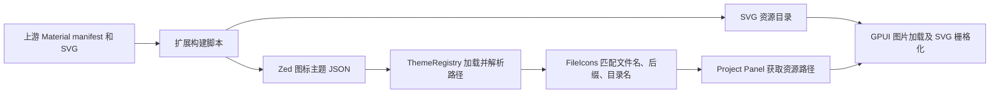

# Material Icon Theme 与 Zed 图标加载调查

## 核查范围

直接检查以下源码快照：

- `zed-extensions/material-icon-theme`：`95cc434119c669e0ff65a6bccfd026ec70e16b63`。
- `zed-industries/zed`：`22580c6e6970de1aebf653a012765025fe8bf0f7`。
- 本仓库：当前工作区的 file explorer、TUI buffer 和 Termina backend。

本文记录源码证据和设计依据。后续实现选择保留 NF 渲染并采用独立主题数据，详见末节。

## 两套 Material 图标需要区分

Zed 的 Material Icon Theme 来源于 VS Code 的 `material-icon-theme`，资源是独立 SVG。它不是 Nerd Fonts 收录的 Material Design Icons 字形集合，两者不能通过替换 Unicode 码点实现相同外观。来源：[扩展 README](https://github.com/zed-extensions/material-icon-theme/blob/95cc434119c669e0ff65a6bccfd026ec70e16b63/README.md)、[生成脚本](https://github.com/zed-extensions/material-icon-theme/blob/95cc434119c669e0ff65a6bccfd026ec70e16b63/src/build.ts)。

## 扩展如何生成主题

`src/build.ts` 调用上游 npm 包的 `generateManifest()`，经 `getTheme()` 转成 Zed JSON，同时复制上游 `icons` 资源目录。扩展自身没有在 Rust 中逐个判断扩展名。来源：[build.ts](https://github.com/zed-extensions/material-icon-theme/blob/95cc434119c669e0ff65a6bccfd026ec70e16b63/src/build.ts)、[package.json](https://github.com/zed-extensions/material-icon-theme/blob/95cc434119c669e0ff65a6bccfd026ec70e16b63/package.json)。

转换后数据分为以下部分。来源：[theme.ts](https://github.com/zed-extensions/material-icon-theme/blob/95cc434119c669e0ff65a6bccfd026ec70e16b63/src/theme.ts)、[类型定义](https://github.com/zed-extensions/material-icon-theme/blob/95cc434119c669e0ff65a6bccfd026ec70e16b63/src/types/icon-theme.ts)。

| 字段 | 内容 |
| --- | --- |
| `file_icons` | 图标 ID → SVG 路径 |
| `file_stems` | 特定文件名 → 图标 ID；这个字段也包含完整文件名，不能仅理解成去扩展名的 stem |
| `file_suffixes` | 文件后缀 → 图标 ID，包括复合后缀 |
| `directory_icons` | 普通目录的 `collapsed` / `expanded` 资源 |
| `named_directory_icons` | 目录名 → 独立的 `collapsed` / `expanded` 资源 |

当前提交的生成 JSON 包含 672 个文件图标定义、9,416 条文件名关联、1,381 条后缀关联、4,659 条目录名关联。这是表项数量，不是不同图标数量；转换脚本会为文件名生成多种大小写变体。来源：[生成 JSON](https://github.com/zed-extensions/material-icon-theme/blob/95cc434119c669e0ff65a6bccfd026ec70e16b63/icon_themes/material-icon-theme.json)、上述 `theme.ts`。

例如，`src` 分别使用 `folder-src.svg` 和 `folder-src-open.svg`；`docs` 使用 `folder-docs.svg` 和 `folder-docs-open.svg`；`node_modules` 使用 `folder-node.svg` 和 `folder-node-open.svg`。因此“专用目录图标展开时保持不变”不是这个主题的实现。

## Zed 如何发现、加载和查询

扩展主机扫描扩展的 `icon_themes` 目录，建立主题名和主题文件的索引，并通过代理请求加载。来源：[extension_host.rs](https://github.com/zed-industries/zed/blob/22580c6e6970de1aebf653a012765025fe8bf0f7/crates/extension_host/src/extension_host.rs)。

`ThemeRegistry::load_icon_theme` 反序列化主题 family，将资源相对路径转换为相对于扩展资源根目录的路径，把默认主题的文件名、后缀和目录名关联与新主题合并，然后注册为共享的 `Arc<IconTheme>`。这是加载阶段的工作，目录每一行不重新读取 JSON。来源：[registry.rs](https://github.com/zed-industries/zed/blob/22580c6e6970de1aebf653a012765025fe8bf0f7/crates/theme/src/registry.rs)、[schema](https://github.com/zed-industries/zed/blob/22580c6e6970de1aebf653a012765025fe8bf0f7/crates/theme/src/icon_theme_schema.rs)。

`FileIcons::get_icon` 查询完整文件名，然后逐步移除点分隔的前缀，查找候选后缀；每个候选先查 `file_stems`，再查 `file_suffixes`。还处理第一段 stem、复合扩展名、隐藏文件名和普通扩展名，最后回退 `default` 图标。由此可以区分 `eslint.config.js`、`Component.stories.tsx` 等文件。图标 ID 解析失败时也可查询默认主题。当前实现没有基于语言识别覆盖这些关联，源码中仍有对应 TODO。来源：[file_icons.rs](https://github.com/zed-industries/zed/blob/22580c6e6970de1aebf653a012765025fe8bf0f7/crates/file_icons/src/file_icons.rs)。

目录按最后一级目录名查 `named_directory_icons`，并选择展开或折叠资源；找不到时查默认主题的同名目录，再回退普通目录图标。查询对名称进行 `trim()`，但没有统一转小写。文件名的部分大小写兼容由扩展生成的数据提供，不能把它描述成 Zed 解析器天然不区分大小写。来源：上述 `file_icons.rs`、扩展 `theme.ts`。

## Zed 如何绘制图标

Project Panel 通过 `FileIcons` 获取资源路径，再交给 `Icon::from_path`。外部主题资源走图片加载路径，`Icon` 注释明确指出这样处理是为了支持多色图标，而非仅用单色 SVG mask。来源：[project_panel.rs](https://github.com/zed-industries/zed/blob/22580c6e6970de1aebf653a012765025fe8bf0f7/crates/project_panel/src/project_panel.rs)、[icon.rs](https://github.com/zed-industries/zed/blob/22580c6e6970de1aebf653a012765025fe8bf0f7/crates/ui/src/components/icon.rs)。

GPUI 图片加载器支持 SVG，调用 SVG renderer 将资源栅格化；renderer 使用 `usvg` / `resvg`。来源：[img.rs](https://github.com/zed-industries/zed/blob/22580c6e6970de1aebf653a012765025fe8bf0f7/crates/gpui/src/elements/img.rs)、[svg_renderer.rs](https://github.com/zed-industries/zed/blob/22580c6e6970de1aebf653a012765025fe8bf0f7/crates/gpui/src/svg_renderer.rs)。

## 对当前 Helix 的设计含义

本地 `helix-term/src/ui/file_explorer.rs` 将图标拼入字符串并调用 `Surface::set_stringn`；`helix-tui/src/buffer.rs` 的 cell 保存字符及样式；`helix-tui/src/backend/termina.rs` 的 `draw` 输出 cell 的 `symbol`。现有 explorer 渲染链没有图片放置接口。将 Zed JSON 中的 SVG 路径直接放进这个字符串不会绘制图标。

可以复用的架构是：主题数据与渲染代码分离；加载时构建索引；文件名和复合后缀优先匹配；每个目录保存展开、折叠两种资源；定义清楚缺失关联和缺失图标的回退规则。

后续设计有两个不同目标：

1. **保留 NF 字体渲染，采用主题数据机制。** 将文件名、后缀、目录名关联放进独立主题资源，Rust 只负责加载和解析。Material Icon Theme 的 SVG 资源不能直接使用，仍需图标 ID 到 NF 字形的适配及缺失回退；外观与上游不等价。
2. **使用 Material Icon Theme 原始 SVG。** 复用其 JSON 和 SVG，增加终端图片后端（例如 Kitty graphics）、SVG 栅格化与缓存、cell 到像素的布局、滚动及隐藏时的图片清理，以及不支持图片的终端回退。此项涉及 TUI 渲染架构，不能当成仅替换文件图标表。

## 本仓库采用的方案

用户明确选择保留 NF 字形渲染，并借鉴 Zed 的主题数据与加载机制。目前实现如下：

- `runtime/icons.toml` 保存默认字形、文件名、后缀、语言 ID 和目录状态关联，编译进程序作为默认主题；Rust 不包含具体文件类型的图标 `match`。
- `helix-term/src/ui/file_icons.rs` 提供通用加载、关联查询、合并与校验。用户配置目录的 `icons.toml` 在侧栏打开时加载，按关联和目录状态覆盖默认数据；无效覆盖记录日志并完整回退默认主题。
- 匹配顺序为完整文件名、由长到短的点分隔后缀、首段文件名、Helix 语言识别，最后默认图标。名称关联采用 ASCII 大小写归一化；图标 ID 保持大小写敏感。
- 目录以最后一级名称选择独立的折叠/展开状态；未定义的状态回退普通目录相应状态。用户仅覆盖一个状态时，另一个内置状态仍然保留。
- 侧栏渲染查询已加载的主题，不在逐行绘制时读取文件。主题在刷新目录时继续复用，关闭后重新打开才重新加载用户配置。
- 没有引入 SVG 或终端图片协议。`contrib/icon-theme/generate.mjs` 从固定提交的上游主题 JSON 导入完整文件名、后缀和目录关联，并利用固定版本 NF 字形表生成 `runtime/icons.toml`；图标 ID 到 NF 字形的适配集中在 `contrib/icon-theme/material-nf.json`，无需修改 Rust。
- 上游 9,416 条文件名关联在 ASCII 大小写归一化后为 2,148 个唯一名称，1,381 条后缀与 4,659 条目录关联均保留。加上本地补充后，生成数据为 2,151 条文件名、1,381 条后缀、4,660 条目录名关联。
- 生成的 1,219 个图标 ID 共使用 136 个不同 NF 字形；NF Material 无对应品牌/框架图标时，400 个文件 ID 和 137 类目录使用通用图标。关联依然保留，不把 ID 数量当成不同字形数量。生成数据共 9,489 行，缩减来自名称去重及 TOML 紧凑格式。
- 生成脚本提供 `--check`，校验生成结果可重复，并保留上游许可到 `runtime/icons.LICENSE`。编辑器运行时不联网。具体维护流程见 `contrib/icon-theme/README.md`。

相关行为通过侧栏渲染场景验证，包含复合后缀优先级、文件名覆盖、字形 ID 覆盖、自定义语言扩展名、目录展开状态、部分覆盖合并，以及无效配置回退。使用说明见 `book/src/pickers.md`。
